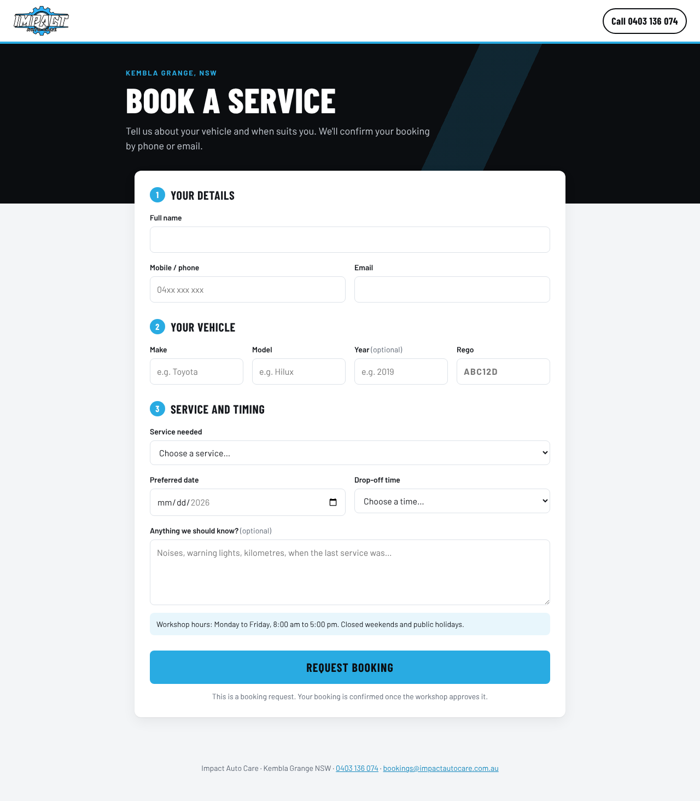
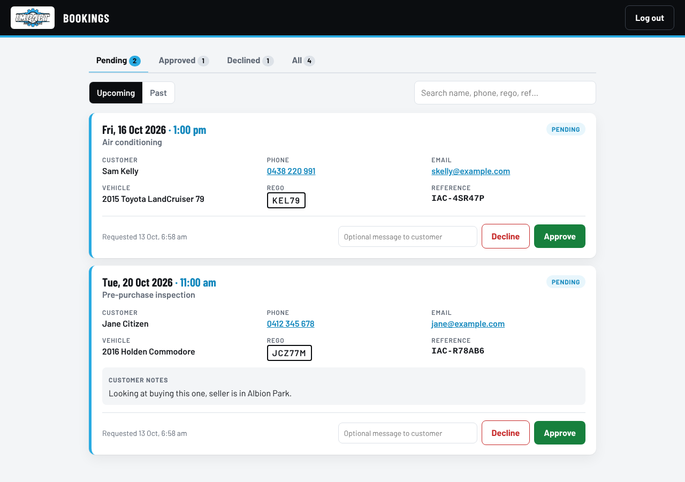

# Impact Auto Care booking app

Customers request a service booking online. Requests arrive as **pending**, and the workshop logs in to an admin page to **approve** or **decline** each one.

- Booking form: `/`
- Admin dashboard: `/admin` (password login)

It's a single small Node.js app. Its only package is nodemailer, used by the Impact Diesel form. Bookings are stored in a SQLite database file.




## What it does

**Customers** fill in name, phone, email, vehicle make/model/year, rego, service needed, preferred date and drop-off time, and notes. They get a reference number like `IAC-7KQ2ZD`. The form blocks weekends, public holidays, past dates and same-day bookings.

**The workshop** logs in at `/admin` and sees:

- Tabs for Pending, Approved, Declined and All, with counts of upcoming bookings
- Upcoming / Past toggle and a search box (name, phone, email, rego, reference)
- One card per booking, with tap-to-call phone and tap-to-email links
- Approve / Decline buttons, with an optional message to the customer
- A warning when other bookings are already approved for the same day
- "Move back to pending" to undo a decision

## Defaults (change them in `config.js`)

| Setting | Default |
|---|---|
| Timezone | `Australia/Sydney` (AEST/AEDT, handled automatically) |
| Open days | Monday to Friday |
| Drop-off times | 8:00 am to 3:00 pm, hourly |
| Booking window | Tomorrow up to 60 days ahead |
| Closed dates | NSW public holidays to end of 2027 (check and add your own shutdowns) |
| Services | Logbook, general service, brakes, air con, transmission, engine diagnostics/repairs, pre-purchase inspection, trailer/caravan, other |
| Dates shown as | Australian format, e.g. Tue, 14 Oct 2026 · 9:00 am |

## Run it locally

Needs Node.js 22.5 or newer.

```bash
ADMIN_PASSWORD=choose-a-password npm start
# open http://localhost:3000 and http://localhost:3000/admin
npm test   # runs the automated tests
```

## Settings (environment variables)

| Variable | Required | What it's for |
|---|---|---|
| `ADMIN_PASSWORD` | Yes | Password for `/admin`. Use something long. |
| `SESSION_SECRET` | Recommended | Random string that keeps admins logged in across restarts. |
| `NODE_ENV=production` | Yes, when live | Turns on secure cookies and requires `ADMIN_PASSWORD`. |
| `DATA_DIR` | When hosted | Folder for the database. Must be on a persistent disk. |
| `TRUST_PROXY=1` | When hosted | Set when running behind the host's HTTPS proxy (Render, Railway, etc). |
| `PORT` | No | Defaults to 3000. Most hosts set this for you. |
| `RESEND_API_KEY`, `EMAIL_FROM` | Optional | Turns on emails: the workshop is emailed on each new request, and the customer gets "received", "confirmed" and "declined" emails. Uses [Resend](https://resend.com) (free tier is plenty). `EMAIL_FROM` must be on a domain verified in Resend, e.g. `Impact Auto Care <bookings@impactautocare.com.au>`. |
| `NOTIFY_EMAIL` | Optional | Where new-request emails go. Defaults to bookings@impactautocare.com.au. |

Without email set up, the app still works: check `/admin` for new requests and use the call/email links on each card.

## Deploying

The app needs a host that runs Node.js **and keeps a persistent disk** (the database is a file). Free tiers that wipe the disk on restart will lose bookings.

### Option A: Render (config included)

1. Put this folder in a GitHub repository.
2. In Render, choose **New > Blueprint** and pick the repository. It reads `render.yaml`.
3. Set `ADMIN_PASSWORD` (and the email settings if wanted) when prompted.
4. Starter plan with a 1 GB disk, roughly US$7–8/month.

### Option B: Any Docker host or VPS

A `Dockerfile` is included. Mount a volume at `/data`:

```bash
docker build -t iac-bookings .
docker run -d -p 3000:3000 -v iac-data:/data -e ADMIN_PASSWORD=... -e SESSION_SECRET=... -e TRUST_PROXY=1 iac-bookings
```

Put it behind HTTPS (most hosts do this automatically).

### Backups

Everything is in `bookings.db` inside `DATA_DIR`. Copy that file to back up.

## Linking it from impactautocare.com.au

1. **Give it a nice address.** In your host, add a custom domain such as `book.impactautocare.com.au`. Then, where the domain's DNS is managed, add the `CNAME` record the host gives you (e.g. `book` → `impact-auto-care-bookings.onrender.com`). HTTPS is issued automatically.
2. **Point the website's booking buttons at it.** The current "Book a service" button links to `tel:0403136074`. Change its link to `https://book.impactautocare.com.au`. Keep "Call to book" as it is for people who prefer to ring.
3. **Bookmark the admin page** on the workshop phone or computer: `https://book.impactautocare.com.au/admin`. On a phone, "Add to Home Screen" makes it feel like an app.

## Impact Diesel Group bookings (`/diesel`)

The same server also runs Impact Diesel Group's heavy vehicle booking form at `/diesel/`, so both workshops share one hosting plan. Its code is in `diesel/` and it shares nothing else with Impact Auto Care (no database, no admin login).

- Customers pick up to 3 preferred drop-off times (8 am to 6 pm, weekdays, Saturday by appointment).
- service@impactdiesel.com.au gets an email with a **Confirm** button per time, or **Suggest another time**.
- The customer is emailed automatically, and can accept a suggested time with one tap or pick new times.
- No database: each booking travels inside signed links in the emails, so the inbox is the record.

| Variable | What it's for |
|---|---|
| `DIESEL_LINK_SECRET` | Long random string that signs the email links. Required. |
| `DIESEL_SMTP_HOST`, `DIESEL_SMTP_PORT`, `DIESEL_SMTP_USER`, `DIESEL_SMTP_PASS` | Outgoing mail server for service@impactdiesel.com.au (the details in Thunderbird's Outgoing Server settings). |
| `DIESEL_WORKSHOP_EMAIL` | Optional. Where requests go. Defaults to service@impactdiesel.com.au. |
| `DIESEL_OUTBOX_KEY` | Optional. Before mail is set up, emails are held at `/diesel/dev/outbox?key=...` for testing. |

To put it on impactdiesel.com.au, paste `diesel/embed-snippet.html` into the page or link a "Book a service" button to `/diesel/`. A custom address such as `book.impactdiesel.com.au` can point at this same service; the form then lives at `book.impactdiesel.com.au/diesel/`.

## Files

```
server.js        web server, database, admin pages
config.js        hours, services, holidays, business details
public/          booking form (index.html, app.js, styles.css, logo)
diesel/          Impact Diesel Group booking app, served at /diesel/
test/            automated tests (npm test)
render.yaml      Render deploy config
Dockerfile       container deploy
screenshots/     what it looks like
```

## Security notes

- Admin login uses a signed, HTTP-only, same-site cookie that expires after 12 hours.
- Login attempts and booking submissions are rate-limited per visitor, and a hidden field catches basic spam bots.
- Admin actions reject cross-site requests.
- Everything customers type is escaped before it's shown in the dashboard.
- There's one shared admin password. If several staff need separate logins later, that can be added.
